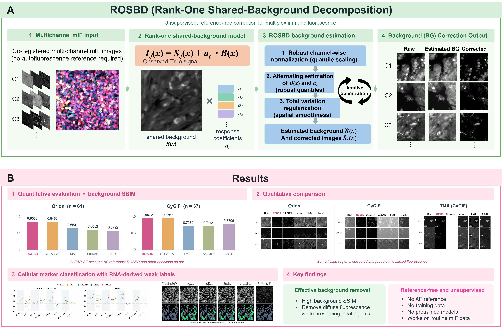

# ROSBD: Reference-Free Background Correction for Spatial Protein Profiling

**Rank-One Shared-Background Decomposition (ROSBD)** is an unsupervised method for estimating and subtracting spatially shared background fluorescence from co-registered multiplex immunofluorescence (mIF) images. It does **not** require a dedicated autofluorescence (AF) reference channel, manually annotated training data, or a pretrained model.

ROSBD is intended for quantitative spatial protein imaging in settings where diffuse background contamination may interfere with marker measurements and downstream cell-level analysis.



## Highlights

- **Reference-free correction:** estimate background directly from the acquired, co-registered fluorescence channels.
- **Interpretable decomposition:** represent shared background using a nonnegative spatial field and channel-specific amplitudes.
- **Robust estimation:** combine channel-wise intensity scaling, alternating quantile updates, and total variation (TV) regularization.
- **Intensity-preserving workflow:** return corrected images and estimated background in the input's original intensity units (as `float32` arrays).
- **Tile-based processing:** apply the core method directly to NumPy arrays or use the repository's dataset-specific whole-slide processing scripts.

## Installation

**Recommended:** Python 3.10. The main ROSBD function requires NumPy and scikit-image; the complete repository requirements additionally cover TIFF/whole-slide processing, comparison methods, and figure generation.

```bash
git clone https://github.com/lyotvincent/ROSBD.git
cd ROSBD
python -m venv .venv
source .venv/bin/activate  # Windows: .venv\Scripts\activate
python -m pip install --upgrade pip
python -m pip install -r requirements.txt
```

For **core-array inference only**, the lighter installation below is sufficient:

```bash
python -m pip install numpy scikit-image
```

The full requirements include BaSiCPy, PyTorch, and a pinned CLEAR-AF source revision for the comparison pipeline. These packages are **not required** to call `shared_background_filter()` itself. Whole-slide TIFF support requires the additional imaging packages listed in [`requirements.txt`](requirements.txt).

## Quick start: correct a multichannel tile

The public API is [`shared_background_filter()`](method.py). Input must be a NumPy array of shape **`[C, H, W]`**, with channels registered to the same tissue coordinates.

```python
import numpy as np
import tifffile
from method import shared_background_filter

# Replace these with co-registered, single-channel grayscale TIFF files.
channel_files = ["CD20.tif", "CD4.tif", "CD8.tif"]
image = np.stack([tifffile.imread(path) for path in channel_files], axis=0)

corrected, info, background = shared_background_filter(
    image,
    q_b=0.4,
    q_a=0.4
)

print("Input:", image.shape)
print("Corrected:", corrected.shape)
print("Iterations:", info["n_iter"])
print("Converged:", info["converged"])

# Save a multichannel floating-point TIFF in the original intensity units.
tifffile.imwrite("corrected.ome.tif", corrected, metadata={"axes": "CYX"})
tifffile.imwrite("estimated_background.ome.tif", background,
                 metadata={"axes": "CYX"})
```

Install `tifffile` for this TIFF-based example (`python -m pip install tifffile`). All input channels must have the same spatial dimensions and order. The example assumes each source TIFF is a 2D grayscale image; for a multichannel OME-TIFF, extract the desired channels before constructing the `[C, H, W]` array.

### Function outputs

```python
corrected, info, background = shared_background_filter(image, ...)
```

| Output | Shape/type | Description |
| --- | --- | --- |
| `corrected` | `[C, H, W]`, `float32` | Background-corrected fluorescence in original intensity units |
| `info` | `dict` | Learned channel coefficients, spatial fields, scaling factors, iteration history, and convergence diagnostics |
| `background` | `[C, H, W]`, `float32` | Estimated background removed from each channel, in original intensity units |

Important `info` entries include `a_normalized`, `a_raw_relative`, `channel_scales`, `b_map`, `b_smooth`, `n_iter`, `converged`, and `history`.

## Parameters

The table below reflects the **current Python function signature** in `method.py` (rather than older comments or experimental configurations).

| Parameter | Default | Role |
| --- | ---: | --- |
| `q_b` | `0.40` | Lower quantile used to estimate the spatial background field across channels |
| `q_a` | `0.40` | Quantile used to update channel-specific background coefficients |
| `scale_percentile` | `99.5` | Percentile of positive intensities used for per-channel scaling |
| `clip_max` | `2.0` | Upper bound applied during coefficient fitting only; `None` disables clipping |
| `tv_weight` | `0.05` | TV regularization strength; `0` disables smoothing |
| `max_iter` | `50` | Maximum number of alternating updates |
| `tol` | `1e-4` | Convergence threshold for channel coefficients |
| `min_b` | `1e-4` | Minimum background amplitude for valid coefficient-update pixels |
| `eps` | `1e-6` | Numerical stability constant |

The repository's [`sdf_params.json`](sdf_params.json) currently uses `q_b=0.4` and `q_a=0.4`. **These are software defaults, not universal or automatically selected settings.** The experimental configurations reported in the manuscript differ by dataset, including `q_b=0.6` for the image-level comparisons and `q_b=0.15` for the exploratory COMET–Xenium analysis. Consult the manuscript and its Supplementary Methods when reproducing a specific analysis.

## Whole-slide / tile-based workflow

The repository contains dataset-specific scripts for **Orion**, **CyCIF**, **breast TMA** (`bmcycif`), and **COMET**. These scripts read pre-split channel TIFFs together with HDF5 files containing tile coordinates, run the correction per tile, and save corrected, background, and raw images.

### Required data layout and configuration

**Before running the whole-slide scripts:** download and prepare the source images separately, then edit the dataset root paths in the appropriate file under [`dataset/`](dataset/).

- `dataset/orion_dataset.py`: per-sample channel OME-TIFF directories and coordinate files.
- `dataset/cycif_dataset.py`: per-sample channel OME-TIFF directories and coordinate files.
- `dataset/bmcycif_dataset.py`: registered breast TMA scene TIFFs and coordinate files.
- `dataset/comet_dataset.py`: COMET multichannel OME-TIFFs and coordinate files. **Note:** its current `DEFAULT_CHANNELS` list includes DAPI; the manuscript's eight-marker COMET correction excludes DAPI, so adjust this selection when reproducing that experiment.

For Orion and CyCIF, the dataset loaders index channel files in per-sample directories. They use `channels.tsv` manifests when present, or fall back to channel filenames. Each coordinate file is an HDF5 file with a `coords` dataset containing tile top-left positions as **`[N, 2]`** integer **`(x, y)`** coordinates at level 0. Coordinate file names must match sample IDs.

### Run ROSBD on an existing dataset

The processing modules use package-relative imports. Run them **from the parent directory of the cloned `ROSBD` folder**, as shown below (after updating dataset paths and preparing coordinate files):

```bash
cd ..  # parent of ROSBD/
python -m ROSBD.run_sdf_wsi_muti_workers \
  --task single \
  --dataset orion \
  --sample-id YOUR_SAMPLE_ID \
  --tile-size 512 \
  --save-dir /path/to/results \
  --worker 4 \
  --sdf-params ROSBD/sdf_params.json
```

Replace `YOUR_SAMPLE_ID` and `/path/to/results` with values matching your local data. Set `--task cohort` and omit `--sample-id` to process the indexed cohort. The script accepts `--overwrite` to reprocess existing sample output directories. Its defaults are 512-pixel tiles for COMET and 256-pixel tiles for other datasets if `--tile-size` is omitted; specify tile size explicitly to match your prepared coordinates.

### Saved output layout

For each processed sample, [`utils.save_tile_outputs`](utils.py) saves files under:

```text
<save-dir>/<sample-id>/<channel-name>/
  result/               # Corrected tile: .tif and display .png
  bg/                   # Estimated removed background: .tif and display .png
  raw/                  # Original tile: .tif and display .png
  result_raw_combinded/ # Side-by-side PNG (corrected | raw)
```

Tile filenames are derived from their upper-left `x_y` coordinates. **TIFF files store original-scale arrays**; PNGs are contrast-normalized previews and should not be used for quantitative evaluation.

## Data preparation and comparison scripts

- [`data/split_orion_channels.py`](data/split_orion_channels.py) and [`data/split_cycif_channels.py`](data/split_cycif_channels.py) provide channel-splitting utilities for the supported OME-TIFF layouts. The CyCIF script requires a channel-name text file.
- [`data/patch_mIF.py`](data/patch_mIF.py) generates tissue-filtered patch coordinates from selected nuclear/reference images.
- [`baseline/`](baseline/) contains comparison implementations for BaSiC, CLEAR-AF, LMSF, and Sauvola; the corresponding WSI launchers are provided at the repository root.
- [`figs/fig_2/`](figs/fig_2/) and [`figs/fig_6/`](figs/fig_6/) contain plotting scripts and exported CSV summaries. For example, `python figs/fig_2/fig.py` generates figure files from the CSVs in that directory.
